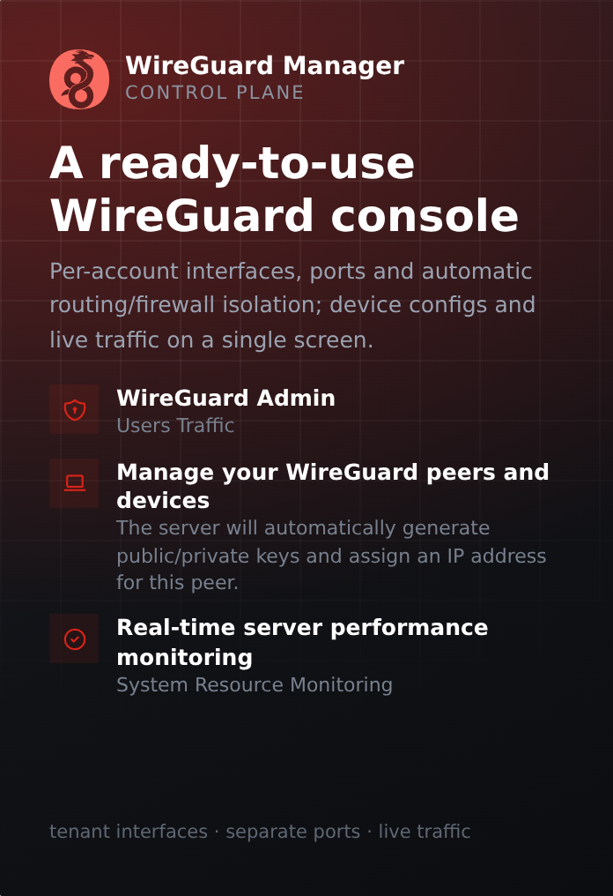
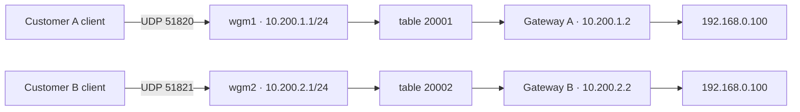

# WireGuard Manager

**English** | [简体中文](README.zh-CN.md)

A multi-tenant WireGuard management platform: every account gets its own interface, UDP port and policy routing table. Client configs are generated in one click, while traffic and online status stay visible in real time.

[](https://github.com/ChouHX/WireguardManager/actions/workflows/build-images.yml)
[](LICENSE)
[](https://go.dev)
[](https://react.dev)
[](https://mantine.dev)
[](https://github.com/ChouHX/WireguardManager/pkgs/container/wireguardmanager-backend)

<p align="center">
  
</p>

## Contents

- [Features](#features)
- [Architecture](#architecture)
- [Quick start](#quick-start)
- [Configuration](#configuration)
- [Windows client](#windows-client)
- [API](#api)
- [Project layout](#project-layout)
- [Local development](#local-development)
- [Operations](#operations)
- [Troubleshooting](#troubleshooting)
- [Security](#security)
- [License](#license)

## Features

- **Account-level isolation** — each account owns its WireGuard interface, UDP port and policy routing table. Different tenants may use the same on-site LAN subnet.
- **Cloud multi-instance** — interfaces live in the host network and handle encrypted UDP directly; no namespaces, veth pairs or DNAT.
- **Automated provisioning** — interfaces and ports are allocated at registration; firewall and routing rules are installed before the interface comes up, with rollback on failure.
- **Ready-to-use devices** — download a `.conf` file or scan a QR code. A Windows client (Go + Wails + Mantine) can log in, connect with its own independent identity, and manage cloud-side gateway routes.
- **Sub-second liveness** — pure Go TCP probes bound to the tenant interface (`SO_BINDTODEVICE`), combined with receive-traffic checks; no agent required.
- **Traffic and resource monitoring** — handshake status, RX/TX counters, and host CPU / memory / disk / network trends in one view.
- **Fine-grained control** — per-device rate limits, enable/disable, gateway target management, custom AllowedIPs, and optional pre-shared keys (PSK).
- **Zero-config deployment** — the JWT secret is generated and persisted on first start; network and monitoring settings live in the admin UI.
- **Modern console** — React 19 + Mantine, compact layout, light/dark themes, English/Chinese UI, mobile-friendly.
- **Lightweight** — embedded SQLite (pure Go, no CGO) in a single container that serves both the console and the API. Images are built and published to GHCR by CI.

## Architecture



One account = one tenant. Interfaces stay in the host network, and `ip rule iif wgmN` selects that tenant's routing table. Multiple interfaces alone cannot isolate overlapping routes, so this project uses dedicated routing tables plus a `WGM-FORWARD` chain that rejects cross-interface forwarding. Missing routes return unreachable instead of falling back to the host default route.

- Server `AllowedIPs` = the device tunnel `/32` plus the on-site subnets behind that gateway.
- `wgmN → wgmN` forwarding is allowed inside a tenant; cross-tenant forwarding, tenant-to-host-egress and inbound plaintext forwarding are blocked.
- `noprefixroute` keeps tunnel prefixes out of the main table; on-site subnets only go into the tenant table.
- Each tenant has its own conntrack zone and loose reverse-path filtering to tolerate overlapping LANs.
- IPv4 forwarding only; tenant interfaces have IPv6 disabled. `10.200.0.0/16` is reserved for tunnels.
- Backend: Go + Gin + GORM. Frontend: React. Windows client: [`client/`](client/README.md) (Go + Wails + React + Mantine, official WireGuardNT).

### Network resource model

| Resource | Allocation |
|---|---|
| WireGuard interface | `wgm1` … `wgm254` (derived from the tunnel index) |
| UDP port | Sequential from `network.base_port` (default `51820`), skipping ports in use |
| Tunnel subnet | `10.200.<index>.0/24`; server `.1`, devices from `.2` |
| Dedicated route table | `20000 + index` (range `20001..20254`) |
| Rule priorities | in-interface `10000 + N`; bound probes `11000 + N`; server tunnel source `12000 + N`; host-to-tunnel `13000 + N` |
| conntrack zone | Same number as the route table |
| Config files | `/etc/wg_config/<user_uid>/wgmN.conf` and `private.key` (0600) |

Reserve these names, route tables and rule priorities for this service. Cloud security groups and host INPUT must allow the allocated UDP ports; the default compose file no longer mounts `/var/run/netns`.

## Quick start

Requirements: Linux host, root/sudo, Docker 24+ with Compose v2, and the `wireguard` kernel module.

```bash
git clone https://github.com/ChouHX/WireguardManager.git
cd WireguardManager

docker compose up -d          # no configuration needed
# or use the deployment script with environment checks
./deploy.sh
# or build from source locally
docker compose -f docker-compose.build.yml up -d --build
```

Defaults: port `3000`, data in `./data`, JWT secret generated into `./data/jwt.secret` on first start.

To change the port (pick one):

```bash
WM_SERVER_PORT=8080 docker compose up -d    # temporary
echo "WM_SERVER_PORT=8080" >> .env          # persist in .env
# or edit the default in docker-compose.yml
```

Open `http://<SERVER_IP>:3000` and log in with `admin@platform.com` / `password` — **change it immediately**.

Image tags can be selected with `WM_IMAGE_TAG` (default `latest`), including `sha-<short-hash>` for rollback:

```bash
WM_IMAGE_TAG=sha-2df1b06 docker compose up -d
```

## Configuration

Everything has a built-in default, so no config file is required. Change **deployment** settings in `docker-compose.yml` (or via env vars) and **runtime** settings in the admin UI ("System Settings").

### Deployment

| Variable | Default | How to override |
|---|---|---|
| Port | `3000` | `WM_SERVER_PORT=8080 docker compose up -d`, `.env`, or compose |
| Data directory | `./data` | Left side of `./data:/root/data` in `docker-compose.yml` |
| Config directory | `./wg_config` | Left side of `./wg_config:/etc/wg_config` |
| JWT secret | Auto-generated | Written to `data/jwt.secret`; or set `WM_JWT_SECRET` |
| Database path | `/root/data/cloud_platform.db` | Backend default, follows the data mount |
| Admin account | `admin@platform.com` / `password` | Created on first start; override with `WM_DEFAULT_ADMIN_*` |
| Image version | `latest` | `image` tag in `docker-compose.yml` |

### Runtime settings

Stored in the database and applied immediately:

| Group | Key | Description |
|---|---|---|
| Network | `network.server_ip` | Public IP/hostname written to client `Endpoint` |
| | `network.out_interface` | Egress interface (auto-detected in the UI) |
| | `network.base_subnet` / `base_port` | Tunnel subnet prefix and starting UDP port |
| | `network.dns` | DNS handed to clients |
| | `network.mtu` | Tunnel MTU, `0` = kernel default (1420); lower it on narrow links |
| Monitoring | `monitoring.interval_seconds` / `retention_hours` | Sampling interval and retention |
| Liveness | `liveness.probe_port` | Probe port (the only parameter that may need manual input) |
| Auth | `jwt.expire_hours` | Login token lifetime |
| Devices | `wireguard.default_preshared_key` | Enable PSK by default for new devices |

The same keys can be seeded with `WM_*` environment variables. Once a value exists in the database, the UI value wins.

### Client configs

The device form only asks for the **device LAN** (`allowed_ips`), e.g. `192.168.0.0/24`. Leave it empty for an ordinary computer. The tunnel `/32` is always kept internally, and overlapping declarations inside one tenant are rejected. Exported configs contain only the tenant tunnel subnet; no `PostUp` / `PreDown` scripts are added.

## Windows client

The desktop client lives in [`client/`](client/README.md). Typical flow:

1. Create one tenant per customer/site and add an on-site gateway device.
2. Log in from the Windows client and select the **remote gateway**. The client registers its own access identity instead of reusing the gateway key.
3. Fill in the forwarding target IP/subnet. Saving updates the gateway's cloud-side AllowedIPs and tenant routes without restarting the gateway.
4. Keep "local access routes" on "follow device targets", or specify narrower `/32`/subnets. Connecting installs the Windows routes and WireGuard AllowedIPs automatically.
5. Closing the window hides to the tray and keeps the tunnel alive.

The gateway itself must enable IPv4 forwarding and have return routing/NAT for the target LAN. Only IPv4 split routing is supported; there is no public-egress or full-tunnel proxy mode. Build, permissions, DPAPI storage and validation steps are documented in the [client README](client/README.md).

## API

All business endpoints are under `/api` (health probes are `/health` and `/ready`) and require `Authorization: Bearer <token>`, except `/api/register` and `/api/login`.

| Method | Path | Description |
|---|---|---|
| `POST` | `/api/register` | Register an account (creates the network environment) |
| `POST` | `/api/login` | Log in and obtain a token |
| `GET` `PATCH` | `/api/me` | Read / update the current account |
| `GET` | `/api/wireguard/traffic` | Current account traffic summary |
| `POST` | `/api/wireguard/access` | Register an independent desktop access identity |
| `GET` `POST` | `/api/wireguard/peers` | List / create devices |
| `PATCH` `DELETE` | `/api/wireguard/peers/{id}` | Update / delete a device |
| `GET` | `/api/wireguard/peers/{id}/config` | Device client config |
| `GET` | `/api/wireguard/interfaces` | Available interfaces and detected egress |
| `GET` | `/api/wireguard/liveness` | Device online status |
| `GET` `PATCH` | `/api/admin/settings` | Read / update runtime settings |
| `GET` | `/api/admin/users` | List users |
| `PATCH` `DELETE` | `/api/admin/users/{id}` | Update / delete a user |
| `GET` | `/api/admin/wireguard/traffic` | All-account traffic summary |
| `GET` | `/api/admin/wireguard/traffic/{id}` | Per-account traffic detail |
| `GET` | `/api/admin/wireguard/liveness` | Online device counts per account |
| `PATCH` | `/api/admin/wireguard/servers/{id}/toggle` | Enable / disable an account network (real up/down) |
| `PATCH` | `/api/admin/wireguard/servers/{id}/ratelimit` | Apply a `tc` rate limit on the tenant interface |
| `DELETE` | `/api/admin/wireguard/servers/{id}` | Delete an account network |
| `POST` | `/api/admin/wireguard/users/{id}/server` | Re-provision a tunnel for an account |
| `GET` | `/api/admin/monitoring/*` | Host monitoring (`system` `cpu` `memory` `disk` `network` `chart` `history` `stats`) |
| `GET` | `/health` `/ready` | Liveness / readiness probes |

`/api/register` and `/api/login` are rate limited per client IP.

## Project layout

```
.
├── main.go                     # Startup, routing, graceful shutdown
├── internal/
│   ├── config/                 # Config loading, validation, env overrides
│   ├── database/               # SQLite init and default admin
│   ├── handlers/               # HTTP handlers
│   ├── middleware/             # Auth and user cache
│   ├── models/                 # Data models
│   ├── routes/                 # Route registration
│   └── services/               # Interfaces, WireGuard, monitoring, liveness
├── frontend/                   # React + Vite + Mantine source
├── client/                     # Windows desktop client (Go + Wails)
├── Dockerfile                  # Single image: Go backend + frontend + wg tools
├── docker-compose.yml          # Default deployment (GHCR image)
├── docker-compose.build.yml    # Build from source
├── wg_config/                  # Mounted at /etc/wg_config
└── data/                       # SQLite database + generated jwt.secret
```

## Local development

```bash
# Backend (needs root for interfaces / policy routing / iptables)
go mod tidy
sudo go run main.go

# Frontend
cd frontend
npm install
npm run dev        # http://localhost:3000, proxies /api to localhost:8080
npm run typecheck
npm run check:locales

# Reset everything (all tenant networks, configs and SQLite data)
sudo ./scripts/cleanup_all.sh
```

Tests:

```bash
go test ./internal/...
bash scripts/test_network.sh   # kernel/network regression inside temporary Docker networks
```

The network test uses `wg/ip/iptables/tc` from `ghcr.io/chouhx/wireguardmanager:latest` (override with `WGM_NETWORK_TEST_IMAGE`). It covers overlapping LANs, identical TCP 5-tuples, cross-tenant blocking, enable/disable/delete recovery, legacy migration and failed rollback.

## Operations

```bash
docker compose ps                             # status
docker compose logs -f app                    # logs
docker compose pull && docker compose up -d   # update to latest image

# Clean up all network resources and local data (disconnects every device)
sudo ./scripts/cleanup_all.sh --dry-run
sudo ./scripts/cleanup_all.sh
sudo ./scripts/cleanup_all.sh --network-only  # keep database and configs
```

**Upgrade:** stop the old container and back up `data/` and `wg_config/`. Coming from the namespace-based version, temporarily mount the legacy netns directory so old interfaces and UDP ports can be released:

```bash
docker compose down
docker compose -f docker-compose.build.yml -f docker-compose.legacy-migration.yml up -d --build
docker compose -f docker-compose.build.yml -f docker-compose.legacy-migration.yml logs -f app
# after every account shows wgmN / UDP <original port>, drop the temporary mount
docker compose -f docker-compose.build.yml up -d
```

Keys, ports, tunnel addresses, devices, PSKs, enable/disable state and rate limits are preserved; clients keep their credentials. Do not roll back to the old image after migration — it cannot understand the new interfaces and policy rules.

Startup rebuilds interfaces, routes and firewall rules before HTTP starts, so tunnels reconnect briefly during a restart. A failed rebuild blocks readiness; a failed device restore leaves that interface down.

## Troubleshooting

**Tunnel connects but data does not flow (MTU).** The default MTU 1420 assumes a 1500-byte link. Behind IPIP/VXLAN/PPPoE, small packets (handshakes, probes) still pass while full-size packets are dropped silently. Set **System Settings → Tunnel MTU** to `link MTU - 60` (e.g. 1300 → 1240, 1492 → 1432). The backend logs a warning when it detects a mismatch. Verify:

```bash
ping -I wgm1 -M do -s 1200 <peer-tunnel-ip>   # works
ping -I wgm1 -M do -s 1400 <peer-tunnel-ip>   # fails => MTU issue
```

**Tunnel connects but the peer receives nothing.** Check `wg show wgm1 latest-handshakes`; `0` means no handshake yet — verify public UDP reachability, keys/PSK on both ends, and that one config is not used by several instances. After a handshake, check the server peer's allowed-ips (it must contain the device tunnel address) and both firewalls. For a read-only report:

```bash
sudo sh scripts/diagnose_network.sh wgm1 10.200.1.2 20 | tee /tmp/wgm-network-diagnosis.txt
```

**Online status.** Every second the server binds the tenant interface and opens a TCP probe to the device tunnel IP at `liveness.probe_port` (default 49151). A completed handshake or `connection refused` means online; otherwise recent receive traffic keeps it online. Two consecutive failures mark it offline (~4 seconds after a client disconnects). Only RX counters are used, because probe SYNs always increase TX.

**The device is connected but shows offline.** Usually the tunnel is down (client exited, network changed, NAT mapping expired) or a client firewall drops probe packets. The device list shows the reason (probe response / tunnel traffic / no response) to help diagnose.

**Registration or first start is slow.** Registration creates the interface, addresses, routes and firewall rules, usually in one or two seconds, and rolls back completely on failure. The first upgrade also migrates legacy namespaces as described above.

**Forgot the admin password?** Stop the service, delete `data/cloud_platform.db`, and restart to recreate the default admin (this also wipes all data). Alternatively update `password_hash` directly in the database.

**Backups and JWT secret.** SQLite data and the JWT secret both live in `data/`. Stop the service and copy the whole directory (including `-wal` and `-shm`). If `jwt.secret` is lost, all issued tokens become invalid. SQLite is designed for a single backend instance; scaling out requires a different database and a redesign of interface/port/route ownership.

## Security

- The JWT secret is generated and stored in `data/jwt.secret` (0600); use a long random value if you set `WM_JWT_SECRET` yourself.
- Change the default admin password immediately. Password changes require the current password, so a leaked token cannot silently take over the account.
- `/api/login` is limited to 10 requests/minute and `/api/register` to 5/hour per IP. Tune with `WM_RATE_LIMIT_LOGIN_PER_MINUTE` / `WM_RATE_LIMIT_REGISTER_PER_HOUR`, or disable with `WM_RATE_LIMIT_ENABLED=false`.
- **Rate limits depend on accurate client addresses.** Gin trusts all proxies by default, which allows `X-Forwarded-For` spoofing; this project trusts none. If you deploy behind a reverse proxy, declare it explicitly, otherwise every request appears to come from the proxy:

  ```yaml
  environment:
    - WM_TRUSTED_PROXIES=172.18.0.1
  ```

  Tighten CORS with `WM_CORS_ORIGINS` (comma-separated). Allowing all origins prints a warning at startup.
- The backend uses the host network to manage WireGuard, iptables and policy routing, and keeps `privileged` to write host forwarding and interface sysctls. Deploy only on controlled hosts and restrict console exposure.
- Container health checks use `/ready` (which actually pings the database), not `/health`.
- Device configs contain private keys; only download them over trusted channels.

## License

[Apache License 2.0](LICENSE)
