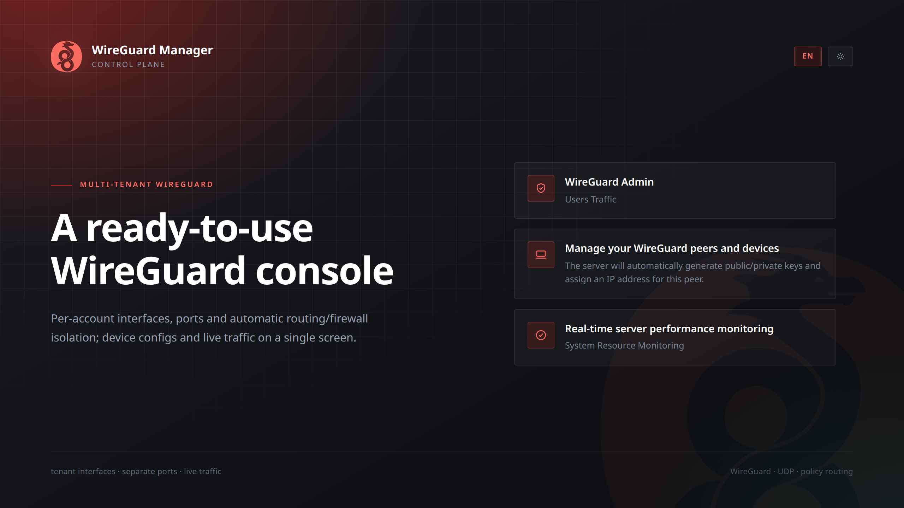
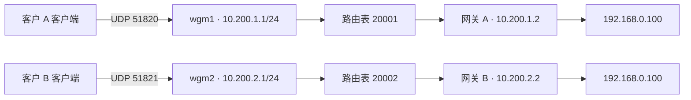

# WireGuard Manager

[English](README.md) | **简体中文**

多租户 WireGuard 管理平台：每个账号独享网卡、UDP 端口与策略路由表；设备配置一键下发，流量与在线状态实时可见。

[](https://github.com/ChouHX/WireguardManager/actions/workflows/build-images.yml)
[](LICENSE)
[](https://go.dev)
[](https://react.dev)
[](https://mantine.dev)
[](https://github.com/ChouHX/WireguardManager/pkgs/container/wireguardmanager-backend)

<p align="center">
  
</p>

## 目录

- [特性](#特性)
- [架构](#架构)
- [快速开始](#快速开始)
- [配置](#配置)
- [Windows 客户端](#windows-客户端)
- [API](#api)
- [目录结构](#目录结构)
- [本地开发](#本地开发)
- [运维](#运维)
- [常见问题](#常见问题)
- [安全提示](#安全提示)
- [许可证](#许可证)

## 特性

- **账号级隔离** —— 每个账号独享 WireGuard 网卡、UDP 端口与策略路由表；不同租户可声明相同现场网段。
- **云端多实例** —— 网卡位于宿主网络，直接收发加密 UDP，不创建 namespace、veth 或 DNAT。
- **自动化编排** —— 注册时分配接口与端口；先建立防火墙隔离与路由规则，再启用接口，失败时整体回滚。
- **设备即开即用** —— 一键生成客户端配置，支持 `.conf` 下载与二维码扫码；Windows 客户端（Go + Wails + Mantine）使用独立身份登录并管理云端转发目标。
- **秒级在线感知** —— 纯 Go TCP 探测绑定租户网卡（`SO_BINDTODEVICE`），结合接收流量判断在线状态，无需客户端 Agent。
- **流量与资源监控** —— 握手状态、收发流量、系统 CPU / 内存 / 磁盘 / 网络趋势一屏掌握。
- **精细管控** —— 设备粒度限速、启用禁用、网关云端目标管理、AllowedIPs 自定义，支持预共享密钥（PSK）。
- **零配置部署** —— JWT 密钥首次启动自动生成并持久化，网络与监控参数全部在管理界面调整。
- **现代控制台** —— React 19 + Mantine，紧凑布局、明暗主题、中英文双语、移动端自适应。
- **轻量部署** —— 嵌入式 SQLite（纯 Go 驱动，无需 CGO），单容器同时提供控制台与 API；镜像由 CI 构建并推送 GHCR。

## 架构



一个账号对应一个租户。所有接口位于宿主网络，通过 `ip rule iif wgmN` 选择该租户的路由表。**仅创建多个网卡并不能隔离重叠路由**，因此本实现使用专属路由表选路，并用 `WGM-FORWARD` 链拒绝跨接口转发；缺少路由时返回 unreachable，不回落到宿主默认路由。

- 服务端 `AllowedIPs` = 设备隧道地址 `/32` + 该网关背后的现场网段。
- 同租户内允许 `wgmN → wgmN` 转发；禁止跨租户、租户到宿主公网出口、外部到租户的明文转发。
- `noprefixroute` 避免向主路由表写入隧道前缀；现场网段仅写入租户表。
- 每租户使用独立 conntrack zone 与宽松反向路径校验，容忍重叠现场网段。
- 仅支持 IPv4 转发；租户接口关闭 IPv6，`10.200.0.0/16` 保留给隧道。
- 后端为 Go + Gin + GORM，前端为 React；Windows 客户端位于 [`client/`](client/README.md)，使用 Go + Wails + React + Mantine 与官方 WireGuardNT。

### 网络资源模型

| 资源 | 分配规则 |
|---|---|
| WireGuard 接口 | `wgm1` … `wgm254`，由隧道序号推导 |
| UDP 端口 | 从 `network.base_port`（默认 `51820`）顺序分配，避让已占用端口 |
| 隧道网段 | `10.200.<序号>.0/24`；服务端 `.1`，设备从 `.2` 起分配 |
| 专属路由表 | `20000 + 序号`（范围 `20001..20254`） |
| 规则优先级 | 入接口 `10000 + N`；绑定出接口的探测 `11000 + N`；服务端隧道源地址 `12000 + N`；本机访问隧道 `13000 + N` |
| conntrack zone | 与专属路由表编号相同 |
| 配置文件 | `/etc/wg_config/<user_uid>/wgmN.conf` 与 `private.key`（0600） |

上述接口名、路由表与规则优先级保留给本服务独占。云安全组及宿主 INPUT 需放行分配的 UDP 端口；默认 compose 不再挂载 `/var/run/netns`。

## 快速开始

前置条件：Linux 主机、root 或 sudo 权限、Docker 24+ 与 Compose v2、`wireguard` 内核模块。

```bash
git clone https://github.com/ChouHX/WireguardManager.git
cd WireguardManager

docker compose up -d          # 无需任何配置
# 或使用带环境检查的部署脚本
./deploy.sh
# 或从源码本地构建
docker compose -f docker-compose.build.yml up -d --build
```

默认端口 `3000`，数据写入 `./data`，JWT 密钥首次启动自动生成到 `./data/jwt.secret`。

指定端口（三选一）：

```bash
WM_SERVER_PORT=8080 docker compose up -d    # 临时指定
echo "WM_SERVER_PORT=8080" >> .env          # 写入 .env
# 或直接修改 docker-compose.yml 的默认值
```

访问 `http://<服务器IP>:3000`，默认账号 `admin@platform.com` / `password`（**首次登录后请立即修改**）。

镜像标签可用 `WM_IMAGE_TAG` 指定（默认 `latest`），也可用 `sha-<短哈希>` 回滚：

```bash
WM_IMAGE_TAG=sha-2df1b06 docker compose up -d
```

## 配置

所有参数都有内置默认值，**无需配置文件**。**部署相关**修改 `docker-compose.yml`（或环境变量），**运行相关**在管理界面「系统设置」中调整。

### 部署参数

| 变量 | 默认值 | 覆盖方式 |
|---|---|---|
| 端口 | `3000` | `WM_SERVER_PORT=8080 docker compose up -d`、`.env` 或 compose |
| 数据目录 | `./data` | 修改 `./data:/root/data` 左侧 |
| 配置目录 | `./wg_config` | 修改 `./wg_config:/etc/wg_config` 左侧 |
| JWT 密钥 | 自动生成 | 写入 `data/jwt.secret`；也可用 `WM_JWT_SECRET` |
| 数据库路径 | `/root/data/cloud_platform.db` | 后端默认值，随数据目录挂载生效 |
| 管理员账号 | `admin@platform.com` / `password` | 首次启动创建，可用 `WM_DEFAULT_ADMIN_*` 覆盖 |
| 镜像版本 | `latest` | 修改 `docker-compose.yml` 中 `image` 的标签 |

### 运行参数

存库即时生效：

| 分组 | 键 | 说明 |
|---|---|---|
| 网络 | `network.server_ip` | 服务器公网 IP / 域名，下发到客户端 Endpoint |
| | `network.out_interface` | 出口网卡（界面可自动探测） |
| | `network.base_subnet` / `base_port` | 隧道网段前缀与端口起始值 |
| | `network.dns` | 下发给客户端的 DNS |
| | `network.mtu` | 隧道 MTU，`0` = 内核默认（1420）；链路较窄时必须调小 |
| 监控 | `monitoring.interval_seconds` / `retention_hours` | 采样间隔与保留时长 |
| 在线判定 | `liveness.probe_port` | 探测端口（唯一可能需要人工指定的参数） |
| 鉴权 | `jwt.expire_hours` | 登录有效期 |
| 设备默认值 | `wireguard.default_preshared_key` | 新建设备是否默认启用 PSK |

同名 `WM_*` 环境变量可设定初始值；数据库中一旦存在该键，以界面上的值为准。

### 客户端配置

设备表单只需填写 **设备局域网**（`allowed_ips`），例如 `192.168.0.0/24`；普通访问电脑可留空。隧道 `/32` 由后台自动保留，同一租户内重叠声明会被拒绝。导出的配置仅包含所属租户的隧道网段，不包含 `PostUp` / `PreDown` 脚本。

## Windows 客户端

桌面客户端位于 [`client/`](client/README.md)，典型流程：

1. 为每个客户 / 现场创建独立租户，并创建现场网关设备。
2. 在 Windows 客户端登录并选择**远端网关**；客户端会注册自己的独立访问身份，不复用网关私钥。
3. 填写「转发目标 IP / 网段」，保存后只更新云端该网关的 AllowedIPs 与租户路由，无需重启网关。
4. 「本机访问路由」保持跟随设备目标，或单独填写更精确的 `/32` / 网段；连接时自动安装 Windows 路由与 WireGuard AllowedIPs。
5. 关闭窗口隐藏到系统托盘并保持连接。

网关需自行启用 IPv4 转发，并具备访问目标 LAN 的路由及正确回程（例如 NAT）。当前仅支持 IPv4 分流，不提供公网出口或全局代理。构建、权限、DPAPI 加密存储及验收步骤见[客户端说明](client/README.md)。

## API

业务接口挂载在 `/api` 下（健康探针为 `/health`、`/ready`），使用 `Authorization: Bearer <token>`；仅 `/api/register`、`/api/login` 无需鉴权。

| 方法 | 路径 | 说明 |
|---|---|---|
| `POST` | `/api/register` | 注册账号（创建网络环境） |
| `POST` | `/api/login` | 登录并获取 Token |
| `GET` `PATCH` | `/api/me` | 查询 / 更新当前账号 |
| `GET` | `/api/wireguard/traffic` | 当前账号流量摘要 |
| `POST` | `/api/wireguard/access` | 注册桌面端独立访问身份 |
| `GET` `POST` | `/api/wireguard/peers` | 列出 / 新增设备 |
| `PATCH` `DELETE` | `/api/wireguard/peers/{id}` | 更新 / 删除设备 |
| `GET` | `/api/wireguard/peers/{id}/config` | 获取设备客户端配置 |
| `GET` | `/api/wireguard/interfaces` | 可用网络接口与探测到的出口 |
| `GET` | `/api/wireguard/liveness` | 设备在线状态 |
| `GET` `PATCH` | `/api/admin/settings` | 查询 / 更新运行参数 |
| `GET` | `/api/admin/users` | 用户列表 |
| `PATCH` `DELETE` | `/api/admin/users/{id}` | 更新 / 删除用户 |
| `GET` | `/api/admin/wireguard/traffic` | 全部账号流量汇总 |
| `GET` | `/api/admin/wireguard/traffic/{id}` | 单个账号流量详情 |
| `GET` | `/api/admin/wireguard/liveness` | 各账号在线设备统计 |
| `PATCH` | `/api/admin/wireguard/servers/{id}/toggle` | 启用 / 禁用账号网络（真实 up/down） |
| `PATCH` | `/api/admin/wireguard/servers/{id}/ratelimit` | 在租户接口上用 `tc` 设置限速 |
| `DELETE` | `/api/admin/wireguard/servers/{id}` | 删除账号网络环境 |
| `POST` | `/api/admin/wireguard/users/{id}/server` | 为账号重新分配隧道 |
| `GET` | `/api/admin/monitoring/*` | 系统监控（`system` `cpu` `memory` `disk` `network` `chart` `history` `stats`） |
| `GET` | `/health` `/ready` | 存活 / 就绪探针 |

`/api/register` 与 `/api/login` 默认按来源地址限速。

## 目录结构

```
.
├── main.go                     # 入口：启动、路由装配、优雅关闭
├── internal/
│   ├── config/                 # 配置加载、校验、环境变量覆盖
│   ├── database/               # SQLite 初始化与默认管理员
│   ├── handlers/               # HTTP 处理层
│   ├── middleware/             # 鉴权与用户缓存
│   ├── models/                 # 数据模型
│   ├── routes/                 # 路由注册
│   └── services/               # 多网卡 / WireGuard / 监控采样 / 存活探测
├── frontend/                   # React + Vite + MantineUI 源码
├── client/                     # Windows 桌面客户端（Go + Wails）
├── Dockerfile                  # 单容器镜像：Go 后端 + 前端产物 + wg 工具链
├── docker-compose.yml          # 默认编排：拉取 GHCR 镜像
├── docker-compose.build.yml    # 本地源码构建编排
├── wg_config/                  # 挂载至 /etc/wg_config
└── data/                       # SQLite 数据库 + 自动生成的 jwt.secret
```

## 本地开发

```bash
# 后端（涉及接口 / 策略路由 / iptables，需要 root）
go mod tidy
sudo go run main.go

# 前端
cd frontend
npm install
npm run dev        # http://localhost:3000，自动代理 /api 到 localhost:8080
npm run typecheck
npm run check:locales

# 重置环境（删除全部租户网络、WireGuard 配置与 SQLite 数据）
sudo ./scripts/cleanup_all.sh
```

测试：

```bash
go test ./internal/...
bash scripts/test_network.sh   # 在临时 Docker 网络中做内核 / 网络回归测试
```

网络测试使用 `ghcr.io/chouhx/wireguardmanager:latest` 镜像中的 `wg/ip/iptables/tc`（可用 `WGM_NETWORK_TEST_IMAGE` 覆盖）。覆盖重复现场地址、相同 TCP 五元组、跨租户阻断、启停及删除恢复、旧布局迁移和失败回滚。

## 运维

```bash
docker compose ps                             # 查看状态
docker compose logs -f app                    # 跟踪日志
docker compose pull && docker compose up -d   # 更新到最新镜像

# 彻底清理网络资源与本地数据（会断开全部在线设备）
sudo ./scripts/cleanup_all.sh --dry-run
sudo ./scripts/cleanup_all.sh
sudo ./scripts/cleanup_all.sh --network-only  # 只清网络，保留数据库与配置
```

**升级：** 升级前停止旧容器并备份 `data/`、`wg_config/`。从 namespace 版本迁移时，需临时挂载历史 namespace 目录以释放旧网卡和 UDP 端口：

```bash
docker compose down
docker compose -f docker-compose.build.yml -f docker-compose.legacy-migration.yml up -d --build
docker compose -f docker-compose.build.yml -f docker-compose.legacy-migration.yml logs -f app
# 日志显示每个账号已使用 wgmN / UDP <原端口> 后，移除临时挂载
docker compose -f docker-compose.build.yml up -d
```

迁移沿用密钥、端口、隧道地址、设备、PSK、启停及限速设置，客户端无需更换凭据。迁移后不要直接回滚旧镜像：旧版本无法识别新接口与策略规则。

启动会先重建接口、路由与防火墙，再开放 HTTP，因此重启期间隧道会短暂重连。重建失败会阻止服务就绪；设备恢复失败时该接口保持 down。

## 常见问题

**隧道能建立，却传不动数据（MTU）。** 默认 MTU 1420 按 1500 字节链路设定。若本机位于 IPIP / VXLAN / PPPoE 等较窄链路之后，握手、探测等小包正常，满长数据包会被静默丢弃。把「系统设置 → 隧道 MTU」改为 `链路 MTU - 60`（如 1300 → 1240，1492 → 1432）。启动日志会给出不匹配告警。可这样确认：

```bash
ping -I wgm1 -M do -s 1200 <对端隧道地址>   # 通
ping -I wgm1 -M do -s 1400 <对端隧道地址>   # 不通 => MTU 问题
```

**隧道能建立，但对端"只发不收"。** 先看 `wg show wgm1 latest-handshakes`，返回 `0` 表示尚未握手，应检查公网 UDP 往返、两端密钥 / PSK，以及同一配置是否被多个实例同时使用。握手成功后，再检查服务端 peer 的 allowed-ips（必须包含设备隧道地址）与两端防火墙。需要只读诊断报告时：

```bash
sudo sh scripts/diagnose_network.sh wgm1 10.200.1.2 20 | tee /tmp/wgm-network-diagnosis.txt
```

**在线状态如何判定。** 服务端每秒绑定设备所属租户的网卡，向设备隧道地址的 `liveness.probe_port`（默认 49151）发起 TCP 探测。完成握手或收到 `connection refused` 即在线；否则最近收到过对端流量也保持在线。连续 2 次失败判定离线（客户端断开后约 4 秒）。只统计接收方向 `rx`，因为探测 SYN 必然让 `tx` 增长。

**设备明明连着，为什么显示离线？** 通常是隧道本身中断（客户端退出、网络切换、NAT 映射失效），或客户端防火墙丢弃了探测包。设备列表会显示判定依据（探测有响应 / 隧道有流量 / 探测无响应）便于排查。

**注册 / 首次启动比较慢？** 注册需要创建租户接口并下发地址、路由与防火墙，通常一两秒完成，失败会整体回滚。首次升级还需按上一节迁移历史 namespace。

**忘记管理员密码？** 停掉服务，删除 `data/cloud_platform.db` 后重启，会重新创建默认管理员（同时清空所有数据）；或直接在数据库中更新 `password_hash`。

**备份与 JWT 密钥。** SQLite 数据与 JWT 密钥都在 `data/`，停服务后整体复制（含 `-wal`、`-shm`）。若 `jwt.secret` 丢失，所有已签发的 Token 会失效。SQLite 面向单实例部署，横向扩容需更换数据库并重新设计接口 / 端口 / 路由归属。

## 安全提示

- JWT 密钥自动生成并保存到 `data/jwt.secret`（0600）；若用 `WM_JWT_SECRET` 显式指定，请使用足够长的随机字符串。
- 默认管理员密码请在首次登录后立即修改。修改密码需提交当前密码，避免 Token 泄漏直接升级为账号接管。
- `/api/login` 默认 10 次/分钟，`/api/register` 默认 5 次/小时（按来源 IP）。可用 `WM_RATE_LIMIT_LOGIN_PER_MINUTE` / `WM_RATE_LIMIT_REGISTER_PER_HOUR` 调整，`WM_RATE_LIMIT_ENABLED=false` 关闭。
- **限速依赖来源地址的准确性。** Gin 默认信任所有代理，任意客户端都能用 `X-Forwarded-For` 伪造地址；本项目默认不信任任何代理。**若确实部署在反向代理之后，必须显式声明代理地址**，否则所有请求都会被记为代理自身地址：

  ```yaml
  environment:
    - WM_TRUSTED_PROXIES=172.18.0.1
  ```

  跨域来源可用 `WM_CORS_ORIGINS`（逗号分隔）收窄；默认放行全部来源时启动日志会给出提示。
- 后端使用 host 网络管理 WireGuard、iptables 与策略路由，并保留 privileged 以写入宿主转发及接口 sysctl。请仅在受控主机部署，并限制控制台暴露范围。
- 容器健康检查指向 `/ready`（会真正 Ping 数据库），而非 `/health`。
- 设备配置包含私钥，下载链路应确保可信。

## 许可证

[Apache License 2.0](LICENSE)
